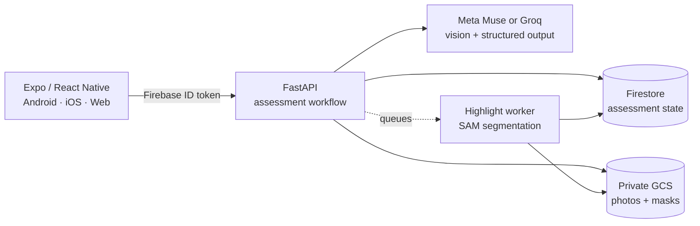

# Home Safety AI

_A fresh set of eyes for the place you call home._


Home Safety AI turns a room photo into an evidence-based, prioritised checklist
for households with older adults, children, babies, and pets. When a photo does
not tell the whole story, it asks for a focused answer or a closer look instead
of pretending to be certain.

> **Home Safety AI provides guidance, not a verdict.** Suggestions are generated
> from visible information only and do not replace a professional home safety
> inspection.

## Official demonstration

[Watch the official Home Safety AI demonstration on YouTube](https://youtu.be/X94i9awvnf0).

## Why it is different

| | Feature | What it means |
| --- | --- | --- |
| 📷 | **One-photo assessment** | Take a photo, choose one from the gallery, or start with a bundled sample. |
| 👨‍👩‍👧‍👦 | **Household-aware guidance** | Tailor an assessment for any combination of older adults, children, babies, and pets—or keep it general. |
| 🔎 | **Evidence, not just labels** | Every finding explains the visible evidence, severity, practical next step, and what the image cannot establish. |
| 💬 | **Focused follow-ups** | Answer a targeted question or add a close-up photo to clarify one finding without starting over. |
| ✅ | **A checklist you control** | Resolve, dismiss, annotate, and reopen findings. AI reviews can add evidence, but only the user changes a finding's status. |
| ✨ | **Optional object highlights** | AI-generated overlays help locate the object behind a finding and can be hidden, reported, or retried. |
| 🔁 | **Honest failure recovery** | Photos and answers survive analysis failures, making retry explicit and preventing an error from looking like an all-clear. |
| 🔐 | **Private, account-scoped records** | Verified accounts own their assessments; photos remain behind the API and are removed with their assessment. |

## From room photo to practical action


_Illustrative journey only—the app reports potential concerns and uncertainty,
not a certified safety result._

```text
Room photo + household context
              │
              ▼
      Visible-evidence analysis
              │
       ┌──────┴──────┐
       ▼             ▼
 Clear finding   Uncertain finding
       │             │
       │      Focused question or photo
       │             │
       └──────┬──────┘
              ▼
   Prioritised room checklist
              │
              ▼
 Resolve · dismiss · reopen · request a review
```

Each finding keeps its identity through follow-ups and photo reviews. New
evidence can revise the explanation, while the user's status and notes remain
theirs. A result with no obvious visible hazards is always presented as a
limited observation—not a declaration that the room is safe.

## How it is built



- **Mobile:** Expo 58, React Native, Expo Router, and encrypted native session
  persistence, with Android as the first physical-device target.
- **API:** FastAPI validates model output, owns assessment workflows, and keeps
  provider credentials off the client.
- **Models:** Meta Muse is the demo provider; Groq is an explicit development
  option. There is no silent provider fallback or automatic model retry.
- **Data:** Firestore stores account-scoped assessment state. Private GCS storage
  retains the initial, follow-up, and review photos plus optional highlight masks.
- **Highlights:** independent, durable attempts use SAM segmentation without
  blocking the main assessment or sibling findings.
- **Deployment:** Docker, Terraform, Artifact Registry, and Cloud Run provide the
  GCP release path in Sydney (`australia-southeast1`) by default.

## Prerequisites

Use a Linux or WSL terminal with Bash for the local and deployment scripts.
Start from a local checkout of this repository, with Git installed.

| Tool or account | Required for |
| --- | --- |
| Node.js **24.22.1** (pinned in [`.nvmrc`](.nvmrc)) and bundled npm | Frontend development, tests, and web builds. The commands below use [nvm](https://github.com/nvm-sh/nvm) to select this version. |
| Python **3.10+** and [uv](https://docs.astral.sh/uv/) | Connected local stack, backend tests, and deployment scripts. |
| Docker Engine or Docker Desktop with Compose v2 | Local Auth, Firestore, and photo-storage emulators; cloud container builds. Docker must be running. |
| A browser | Local web testing and the hosted web app. |
| Meta Muse or Groq API credentials | Real AI assessments locally. The guided cloud deployment uses Muse. Preview and automated tests do not need model credentials. |
| Google Cloud project with billing, Google Cloud CLI (`gcloud`), Terraform **>=1.14 and <2**, and Firebase CLI | Cloud deployment only; see [Deploy on GCP + Firebase](#deploy-on-gcp--firebase). |

On WSL, use Linux Node and npm inside WSL and enable Docker Desktop integration
for the distribution. An Android phone with an Expo Go version compatible with
Expo SDK **58**, or Android Studio with an emulator, is optional. Neither is
needed for browser testing.

## Deploy Locally

These instructions run the development stack on your machine. Run every command
below from the repository root unless stated otherwise.

### 1. Install dependencies

```bash
nvm install
nvm use
npm --prefix mobile ci
uv sync --project backend --extra dev --locked
docker compose version
```

There is no root npm project; frontend dependencies live in `mobile/`. If you
already have a compatible Node installation, you can skip the nvm commands.
An ignored project-local runtime, when available, can instead be selected with
`source scripts/frontend-env.sh`; that script does not install Node.

### 2. Configure the local environment

If a root `.env` does not already exist, create it from the supplied template:

```bash
cp -n .env.example .env
```

Edit `.env` and replace the model credentials. For Muse:

```dotenv
MODEL_PROVIDER=muse
MUSE_API_KEY=your-meta-api-key
MUSE_MAIN_MODEL=muse-wonder-1.0
```

Alternatively, set `MODEL_PROVIDER=groq`, `GROQ_API_KEY`, and `GROQ_MODEL`.
There is no automatic provider fallback. Leave `MUSE_IMAGE_GEN_MODEL` empty
unless you want optional room concepts and have access to an image model.
Highlights require the Muse provider and `MUSE_SEGMENTATION_MODEL`; set
`MUSE_SEGMENTATION_MODEL=` to disable them.

Keep the template's local storage and Firebase emulator settings, including
`GOOGLE_CLOUD_PROJECT=home-safety-local`,
`FIREBASE_AUTH_EMULATOR_HOST=127.0.0.1:9099`, and the matching
`EXPO_PUBLIC_FIREBASE_PROJECT_ID=home-safety-local`. No cloud project, Firebase
registration, or Google Cloud login is needed locally. Model keys stay in the
ignored root `.env`; never give them an `EXPO_PUBLIC_` prefix.

### 3. Start the app and verify an account

```bash
python3 scripts/local-test.py start
```

This starts the Auth, Firestore, and photo-storage emulators, FastAPI, the
chat/highlight worker, and Expo. Services run in the background after the command
returns. Initial startup needs network access to download container images and
emulator dependencies. Keep ports **9099**, **8080**, **4443**, **8000**, and
**8081** available.

1. Open <http://localhost:8081>. API health is at <http://127.0.0.1:8000/health>.
2. Register an email/password account in the app and request email verification.
3. Find the verification link in the Auth emulator logs:

   ```bash
   docker compose -f backend/compose.yaml logs auth
   ```

4. Open the link, then return to the app and refresh or sign in again. Emulator
   emails are not sent to a real mailbox.
5. Select a bundled room or upload a photo, run an assessment, try finding chat,
   and update a checklist item. Connected AI requests consume provider quota.

Logs are in `.tools/local-test/` (`backend.log`, `worker.log`, and
`frontend.log`). Keep the worker running for chat replies and highlights.
Restart Expo after changing client configuration. This launcher uses loopback
addresses for browser testing; for phones, follow
[frontend development](docs/frontend-development.md) and
[account setup](docs/authentication.md#local-development).

Stop the stack gracefully to preserve emulator accounts, assessments, and photos:

```bash
python3 scripts/local-test.py stop
```

See the [local stack guide](docs/test/local-stack.md) for troubleshooting and the
[backend guide](backend/README.md#start-locally) for manual service startup.

### Optional: frontend preview without an API

With frontend dependencies installed, run:

```bash
python3 scripts/local-test.py start --preview
```

Open <http://localhost:8081>. Preview uses predefined scenarios and does not
analyse your photo; it needs no backend dependencies, Docker, `.env`, accounts,
or model key. Stop it with `python3 scripts/local-test.py stop` before switching
to the connected stack.

## Deploy on GCP + Firebase

The backend runs on **Cloud Run**, with Firestore, private GCS photos, and
Cloud Tasks/Scheduler workers. **Firebase Authentication** supplies accounts and
**Firebase Hosting** serves the exported Expo web app. Deployment defaults to
project `home-safety-ai` and region `australia-southeast1` (Sydney); review the
[deployment guide](deploy/README.md) for project configuration, required IAM
permissions, release verification, and rollback before provisioning.

### 1. Prepare tools, Firebase, and credentials

Install the shared dependencies above plus gcloud, Terraform, and the Firebase
CLI. From the repository root:

```bash
nvm use
npm --prefix mobile ci
uv sync --project backend --extra dev --locked
npm install --global firebase-tools
gcloud auth login
firebase login
```

Use the same Google account and project for both CLIs, with billing enabled and
permissions to provision and release the resources listed in the deployment
guide. Before running the guided deployment:

1. Add Firebase to the target GCP project, enable email/password authentication,
   and register a Firebase **web app** in that project.
2. Create and verify a test account for deployment checks. See
   [authentication setup](docs/authentication.md#deployment) for provider setup,
   email actions, and account requirements.
3. Create the ignored root `.env` if needed and set the values below using that
   project's Firebase web configuration and your verified test account:

   ```dotenv
   MODEL_PROVIDER=muse
   MUSE_API_KEY=your-meta-api-key
   MUSE_MAIN_MODEL=muse-wonder-1.0
   EXPO_PUBLIC_DATA_SOURCE=api
   EXPO_PUBLIC_FIREBASE_PROJECT_ID=home-safety-ai
   EXPO_PUBLIC_FIREBASE_API_KEY=your-firebase-web-api-key
   EXPO_PUBLIC_FIREBASE_APP_ID=your-firebase-web-app-id
   EXPO_PUBLIC_FIREBASE_AUTH_DOMAIN=home-safety-ai.firebaseapp.com
   HOME_SAFETY_SMOKE_EMAIL=your-verified-test-account-email
   HOME_SAFETY_SMOKE_PASSWORD=your-test-account-password
   ```

Remove local emulator settings from the cloud configuration, including
`FIREBASE_AUTH_EMULATOR_HOST`, `FIRESTORE_EMULATOR_HOST`,
`STORAGE_EMULATOR_HOST`, and `EXPO_PUBLIC_AUTH_EMULATOR_URL`. Replace the local
Firebase values with cloud values; keep a private copy of your local settings
if you plan to switch back. Test-account credentials and model keys stay private.

### 2. Deploy the backend

```bash
python3 scripts/deploy.py start
```

Review the Terraform plans and enter the confirmations requested by the script.
It provisions infrastructure, stores model secrets, releases and verifies the API,
configures workers, and writes the current Cloud Run URL to `.env` as
`EXPO_PUBLIC_API_URL`. Re-running `start` updates the deployment. Keep the
checkout's ignored Terraform state and private backups for future operations.

### 3. Publish the web app to Firebase Hosting

Once the backend deployment succeeds:

```bash
backend/.venv/bin/python scripts/deploy-web.py start
```

The script discovers the backend URL, exports the frontend, configures Hosting
authentication domains and API CORS, deploys Hosting, and prints the public URL.
It checks Hosting, API health, and CORS. Open that URL and verify sign-in, photo
selection, an assessment, finding chat, history, and a page refresh yourself.
See the [browser deployment guide](deploy/README.md#browser-demo) for project/site
overrides and build-only operation. For Expo Go against the cloud backend, use
`python3 scripts/deploy.py start --stage finish --start-expo`.

### Stop hosting or remove cloud resources

To take the website offline while retaining the backend and saved data:

```bash
backend/.venv/bin/python scripts/deploy-web.py stop
```

To destroy the managed backend infrastructure and its stored assessments/photos:

```bash
python3 scripts/deploy.py stop
```

Backend teardown requires a typed confirmation and does not disable Firebase
Hosting or remove Firebase accounts. Cloud resources can incur charges until
removed; there is no automatic teardown. Follow the
[deployment guide](deploy/README.md#explicit-teardown) for teardown details.

## Project map

| Path | Purpose |
| --- | --- |
| [`mobile/app/`](mobile/app/) | Expo Router screens and navigation |
| [`mobile/src/components/`](mobile/src/components/) | Shared UI, finding cards, photos, and highlights |
| [`mobile/src/domain/`](mobile/src/domain/) | Assessment, finding, and checklist state |
| [`mobile/src/api/`](mobile/src/api/) | FastAPI client, photo uploads, and explicit preview service |
| [`mobile/src/storage/`](mobile/src/storage/) | Session, state, and retained-photo persistence |
| [`backend/`](backend/) | FastAPI workflows, model adapters, Firestore/GCS storage, and tests |
| [`scripts/local-test.py`](scripts/local-test.py) | Local frontend, API, worker, and emulator orchestration |
| [`deploy/terraform/`](deploy/terraform/) | Cloud Run, storage, registry, queue, and IAM infrastructure |
| [`docs/test/`](docs/test/) | Automated checks, manual journeys, and device testing |

## Current scope

Home Safety AI is an MVP, not a safety certification system. It supports the
latest assessment experience rather than a full history browser. It does not do
live surveillance, floor-plan mapping, contractor booking, shopping, or hidden
hazard detection. Native camera, accessibility, and device behaviour still need
verification on each target platform before a production release.

The domain language, behavioural boundaries, and technical decisions are
documented in [CONTEXT.md](CONTEXT.md).
