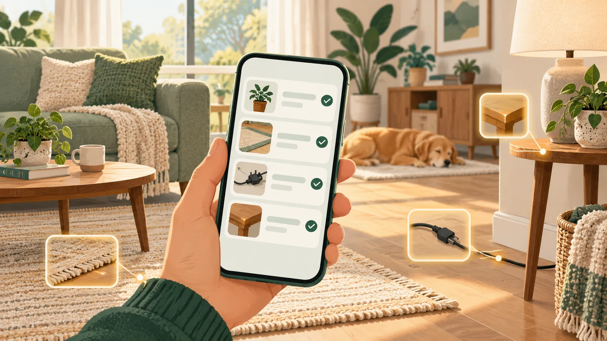
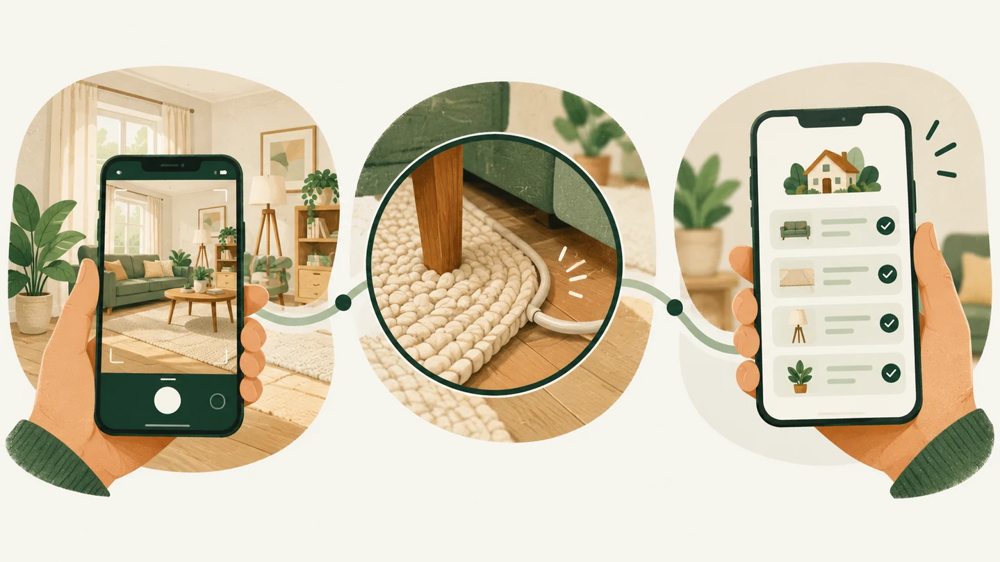
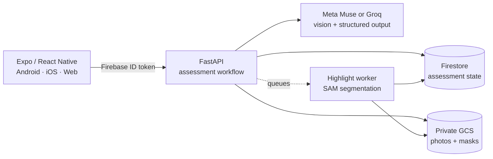

# Home Safety AI

_A fresh set of eyes for the place you call home._



Home Safety AI turns a room photo into an evidence-based, prioritised checklist
for households with older adults, children, babies, and pets. When a photo does
not tell the whole story, it asks for a focused answer or a closer look instead
of pretending to be certain.

> **Home Safety AI provides guidance, not a verdict.** Suggestions are generated
> from visible information only and do not replace a professional home safety
> inspection.

## Why it is different

| | Feature | What it means |
| --- | --- | --- |
| 📷 | **One-photo assessment** | Take a photo, choose one from the gallery, or start with a bundled sample. |
| 👨‍👩‍👧‍👦 | **Household-aware guidance** | Tailor an assessment for any combination of older adults, children, babies, and pets—or keep it general. |
| 🔎 | **Evidence, not just labels** | Every finding explains the visible evidence, severity, practical next step, and what the image cannot establish. |
| 💬 | **Focused follow-ups** | Answer a targeted question or add a close-up photo to clarify one finding without starting over. |
| ✅ | **A checklist you control** | Resolve, dismiss, annotate, and reopen findings. AI reviews can add evidence, but only the user changes a finding's status. |
| ✨ | **Optional object highlights** | AI-generated overlays help locate the object behind a finding and can be hidden, reported, or retried. |
| 🔁 | **Honest failure recovery** | Photos and answers survive analysis failures, making retry explicit and preventing an error from looking like an all-clear. |
| 🔐 | **Private, account-scoped records** | Verified accounts own their assessments; photos remain behind the API and are removed with their assessment. |

## From room photo to practical action



_Illustrative journey only—the app reports potential concerns and uncertainty,
not a certified safety result._

```text
Room photo + household context
              │
              ▼
      Visible-evidence analysis
              │
       ┌──────┴──────┐
       ▼             ▼
 Clear finding   Uncertain finding
       │             │
       │      Focused question or photo
       │             │
       └──────┬──────┘
              ▼
   Prioritised room checklist
              │
              ▼
 Resolve · dismiss · reopen · request a review
```

Each finding keeps its identity through follow-ups and photo reviews. New
evidence can revise the explanation, while the user's status and notes remain
theirs. A result with no obvious visible hazards is always presented as a
limited observation—not a declaration that the room is safe.

## Try the experience

### Fast path: simulated preview

Preview mode runs entirely on the frontend with predefined scenarios, so it
does not require Docker, cloud credentials, or a model API key.

```bash
nvm use
cd mobile
npm ci
EXPO_PUBLIC_DATA_SOURCE=preview npm run web
```

Open <http://localhost:8081>, choose **Start with a room**, and use a bundled
sample or your own photo. The development preview selector includes everyday
hazards, uncertain findings, a qualified no-hazards result, and recoverable
failure scenarios. Preview results are simulated and do not analyse the chosen
photo.

### Full path: connected AI stack

The connected experience runs Expo, FastAPI, the storage emulators, and the
independent highlight worker together.

1. Install the prerequisites listed below.
2. Copy `.env.example` to `.env` if a root `.env` does not already exist.
3. Add either Meta Muse or Groq credentials to `.env`; never place model keys in
   frontend configuration.
4. Start the stack from the repository root:

```bash
python3 scripts/local-test.py start
```

Open <http://localhost:8081> when the script reports ready. Logs are written to
`.tools/local-test/`. Stop all managed services gracefully with:

```bash
python3 scripts/local-test.py stop
```

Graceful shutdown preserves emulator data. See the
[local stack guide](docs/test/local-stack.md) for logs and troubleshooting.

## How it is built



- **Mobile:** Expo 58, React Native, Expo Router, and encrypted native session
  persistence, with Android as the first physical-device target.
- **API:** FastAPI validates model output, owns assessment workflows, and keeps
  provider credentials off the client.
- **Models:** Meta Muse is the demo provider; Groq is an explicit development
  option. There is no silent provider fallback or automatic model retry.
- **Data:** Firestore stores account-scoped assessment state. Private GCS storage
  retains the initial, follow-up, and review photos plus optional highlight masks.
- **Highlights:** independent, durable attempts use SAM segmentation without
  blocking the main assessment or sibling findings.
- **Deployment:** Docker, Terraform, Artifact Registry, and Cloud Run provide the
  GCP release path in `us-central1`.

## Prerequisites

- Git and a local checkout of this repository.
- Node.js **24.22.1**, pinned in [`.nvmrc`](.nvmrc), with its bundled npm.
- Python **3.10+** and [uv](https://docs.astral.sh/uv/) for the backend.
- Docker Engine with Compose for the Firestore and photo-storage emulators.
- A browser for web preview.
- Optional: an Android phone with an Expo Go version compatible with Expo SDK
  **58**, or Android Studio for an emulator.

On WSL, run Linux Node and npm inside WSL and enable Docker Desktop integration
for the distribution. Browser preview and a physical phone using Expo Go do not
require Android Studio.

### Install frontend dependencies

```bash
nvm install
nvm use
cd mobile
npm ci
```

`npm ci` must run in `mobile/`; there is no root npm project. This checkout may
also contain an ignored, project-local Node runtime. To use it when available:

```bash
source scripts/frontend-env.sh
cd mobile
npm ci
```

The script selects the project-local runtime when present and otherwise uses
Node from `PATH`; it does not install Node.

### Install backend dependencies

```bash
docker compose version
cd backend
uv sync --extra dev --locked
```

Configure one model provider in the root `.env`:

```dotenv
MODEL_PROVIDER=muse
MUSE_API_KEY=your-meta-api-key
MUSE_MAIN_MODEL=muse-wonder-1.0
```

To use Groq, set `MODEL_PROVIDER=groq`, `GROQ_API_KEY`, and `GROQ_MODEL` instead.
See the [backend guide](backend/README.md#start-locally) for the full provider,
storage, and HTTP contract.

### Configure the connected frontend

The root `.env` is shared by the launch scripts. Public client values are safe
to expose; model credentials are not.

```dotenv
EXPO_PUBLIC_DATA_SOURCE=api
EXPO_PUBLIC_API_URL=http://127.0.0.1:8000
EXPO_PUBLIC_AUTH_EMULATOR_URL=http://127.0.0.1:9099
EXPO_PUBLIC_FIREBASE_PROJECT_ID=home-safety-local
EXPO_PUBLIC_FIREBASE_API_KEY=local-emulator-key
EXPO_PUBLIC_FIREBASE_APP_ID=home-safety-local
```

Register and verify an email/password account before accessing assessments.
Restart Expo after changing configuration. Physical phones need a reachable API
URL rather than `127.0.0.1`; see [frontend development](docs/frontend-development.md)
and [account setup](docs/authentication.md).

## Quality and safety by design

- The server accepts findings only through a strict, validated schema.
- Findings are capped, severity-ordered, and paired one-to-one with checklist
  actions.
- Uncertainty is a required part of every finding, not hidden metadata.
- A later photo cannot silently mark a finding resolved; the user makes the final
  call.
- Dangerous DIY instructions are excluded in favour of leaving the area or
  seeking qualified help where appropriate.
- Failed initial analysis is shown as a failure with Retry, never as an empty
  or successful assessment.
- Model credentials, raw image payloads, and private photos stay out of logs.

Automated coverage includes frontend state and browser journeys, backend
workflows, authentication and ownership, provider boundaries, Firestore/GCS
round trips, highlight recovery, container behaviour, and deployment tooling.
See [testing guides](docs/test/README.md) for commands and manual device checks.

## Project map

| Path | Purpose |
| --- | --- |
| [`mobile/app/`](mobile/app/) | Expo Router screens and navigation |
| [`mobile/src/components/`](mobile/src/components/) | Shared UI, finding cards, photos, and highlights |
| [`mobile/src/domain/`](mobile/src/domain/) | Assessment, finding, and checklist state |
| [`mobile/src/api/`](mobile/src/api/) | FastAPI client, photo uploads, and explicit preview service |
| [`mobile/src/storage/`](mobile/src/storage/) | Session, state, and retained-photo persistence |
| [`backend/`](backend/) | FastAPI workflows, model adapters, Firestore/GCS storage, and tests |
| [`scripts/local-test.py`](scripts/local-test.py) | Local frontend, API, worker, and emulator orchestration |
| [`deploy/terraform/`](deploy/terraform/) | Cloud Run, storage, registry, queue, and IAM infrastructure |
| [`docs/test/`](docs/test/) | Automated checks, manual journeys, and device testing |

## Deploy to GCP

Provisioning and application releases are separate, guarded operations. Follow
the [deployment guide](deploy/README.md) for one-time credentials, Terraform,
release verification, traffic promotion, and rollback. The convenience wrapper
at the repository root exposes the managed lifecycle:

```bash
export PATH="$PWD/bin:$PATH"
deploy start
deploy stop
```

`deploy stop` deletes infrastructure and stored assessments/photos only after a
typed confirmation.

## Current scope

Home Safety AI is an MVP, not a safety certification system. It supports the
latest assessment experience rather than a full history browser. It does not do
live surveillance, floor-plan mapping, contractor booking, shopping, or hidden
hazard detection. Native camera, accessibility, and device behaviour still need
verification on each target platform before a production release.

The domain language, behavioural boundaries, and technical decisions are
documented in [CONTEXT.md](CONTEXT.md).
